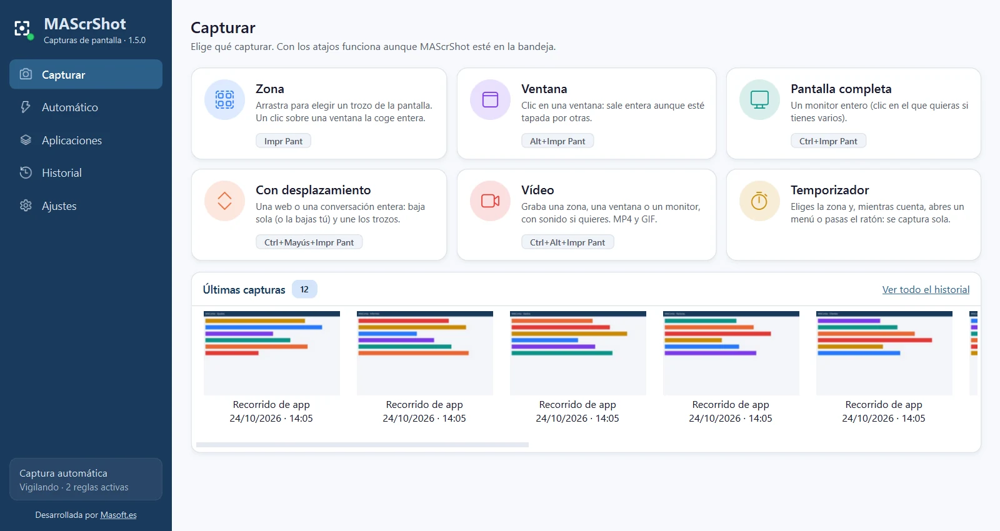
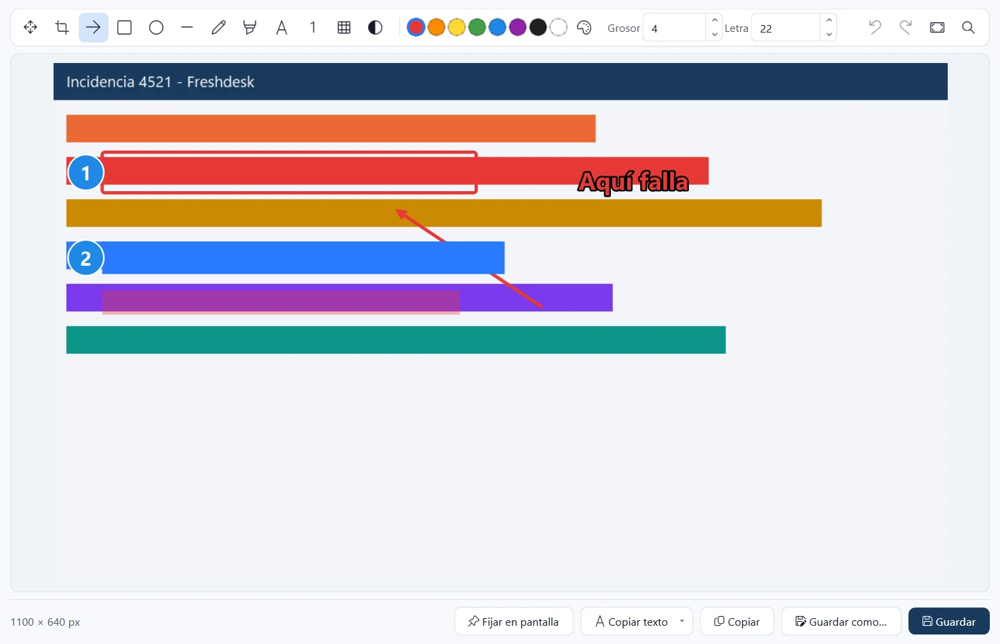
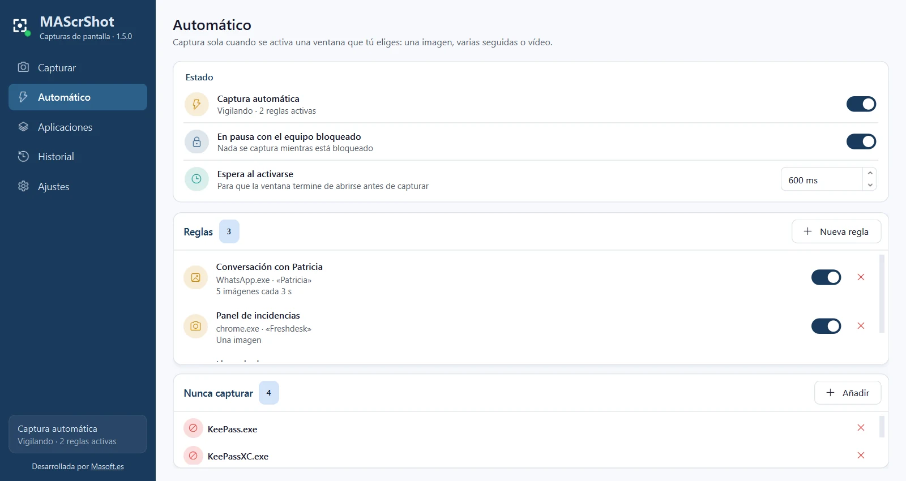
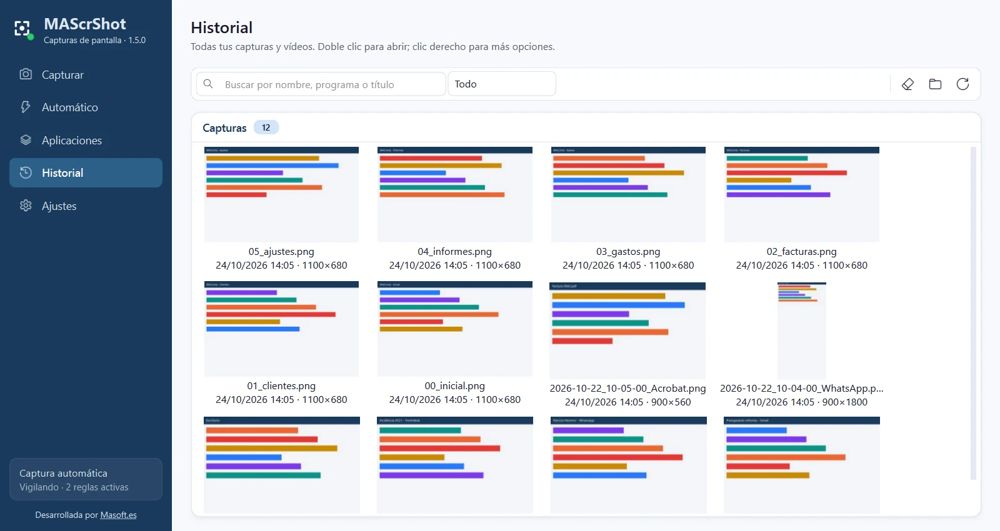

# MAScrShot

Capturas de pantalla para el día a día: una zona, una ventana o la pantalla entera, capturas largas con desplazamiento (webs y conversaciones enteras), vídeo con sonido y captura automática cada vez que se activa la ventana que eliges. Con editor para marcar y tapar datos.

**Software gratuito desarrollado por [Masoft.es](https://masoft.es)**

[](https://github.com/MaSoft/MAScrShot/releases/latest)

También puedes descargarlo desde [masoft.es](https://masoft.es/descargas.html).



## Características
- Zona con lupa de píxeles y medidas, ventana entera aunque esté tapada, sin la sombra de Windows, y pantalla completa.
- Capturas con desplazamiento: webs y conversaciones enteras en una sola imagen, quitando lo que se repite.
- Vídeo de una zona, una ventana o un monitor con el sonido del equipo, del micrófono o de los dos; pausa, clics resaltados, MP4 y GIF.
- Captura automática por programa y título de ventana: una imagen, una ráfaga o vídeo cada vez que se activa.
- Aplicaciones: abre un programa y captura todas sus pantallas con un botón, o sigue una receta de pasos.
- Editor para recortar, marcar y pixelar o difuminar datos; fijar la captura encima de todo.
- Copiar el texto de una captura (normal, con formato o el exacto del programa) sin enviar la imagen a ningún sitio.
- Barra flotante, atajos con Impr Pant configurables, historial con miniaturas, tema claro y oscuro y manual con F1.

## Capturas

| | |
|---|---|
| <br>**Editor.** Flechas, recuadros, texto, números de paso, resaltador y pixelar o difuminar datos antes de compartir. | <br>**Captura automática.** Reglas por programa y título: una imagen, una ráfaga o vídeo cada vez que se activa esa ventana. |
| <br>**Historial.** Todas las capturas y vídeos con miniatura: abrir, editar, copiar, fijar o hacer GIF. |  |

## Requisitos

| | |
|---|---|
| Sistema | Windows 10 (versión 2004 o posterior recomendada) u 11 de 64 bits |
| Permisos | Usuario normal: no necesita administrador |
| Instalación | No hace falta: un solo .exe que se copia y se abre. Tarda unos segundos más en arrancar porque se descomprime en la carpeta temporal |
| Espacio | 121 MB el programa (incluye el motor de vídeo ffmpeg); las capturas y los vídeos, aparte |
| Copiar el texto | El reconocimiento de texto de Windows en español (suele venir instalado) |

Guarda sus ajustes, el historial y los registros en una carpeta junto al .exe. El motor de vídeo es ffmpeg (licencia GNU GPL v3): su licencia y dónde conseguir su código fuente están en el manual, en el aviso legal.

## Descarga y comprobación

En [Releases](https://github.com/MaSoft/MAScrShot/releases/latest) están el programa (`MAScrShot_v1.5.0.exe`), su huella SHA-256 y el manual. Para comprobar que la descarga está completa, en PowerShell:

```powershell
Get-FileHash .\MAScrShot_v1.5.0.exe
```

Debe coincidir con `72e56dcb30227966f7c60f75435fc93d63ec9edadc1fd51a7bec5ed902ff0cc7`.

## Manual

[manual_MAScrShot.html](https://github.com/MaSoft/MAScrShot/releases/latest/download/manual_MAScrShot.html): descárgalo y ábrelo en el navegador.

## Aviso legal

MAScrShot es gratuito y se entrega tal cual, sin garantía de ningún tipo. Al descargarlo y usarlo aceptas el aviso legal y las limitaciones de su manual.

> Capturar y grabar a otras personas. Grabar la pantalla o el sonido de una llamada, una videoconferencia o una conversación puede requerir informar a los participantes y, según el país y el uso, su consentimiento. La captura automática no debe usarse para vigilar a otras personas sin su conocimiento (en el trabajo, la normativa laboral y de protección de datos exige informar). La responsabilidad del uso es de quien lo configura.

**Limitaciones**
- Las capturas y los vídeos pueden contener datos personales o confidenciales: se guardan sin cifrar en la carpeta elegida. Usa pixelar o difuminar antes de compartirlas.
- Lo automático depende del título y del programa de la ventana; si un programa cambia su título, la regla puede dejar de encajar.
- El contenido protegido (vídeo con DRM, algunas aplicaciones bancarias) puede salir en negro: es Windows quien lo impide.
- La captura con desplazamiento une por coincidencia de imagen: con contenido que se mueve o se repite idéntico puede no encajar.
- El reconocimiento de texto es el de Windows: puede equivocarse con letra pequeña o fondos complicados. Con formato, el tamaño y el color son aproximados y el tipo de letra y la negrita no se copian.
- El texto exacto del programa se guarda en el historial (DATA\historial.db) junto a la captura, sin cifrar, igual que la propia imagen. Las contraseñas nunca se guardan.
- La sección Aplicaciones pulsa controles de verdad en el programa: lo automático solo pulsa pestañas, listas y árboles de navegación y abre menús sin pulsar sus opciones; con Diálogos «…» encendido también pulsa esos botones (salvo los de las palabras prohibidas) y depende de que el programa siga el convenio de que «…» abre una ventana. Una receta hace lo que se le diga. Prueba con datos de prueba, nunca sobre datos reales importantes.
- «Tapar datos» pixela lo que Windows declara como campos de texto o celdas; un dato dibujado de otra forma (una etiqueta, una imagen) no se tapa: revisa las capturas antes de compartirlas.
- La sección Aplicaciones depende de la accesibilidad de Windows: un control sin nombre accesible o dibujado a mano (juegos, lienzos) no se puede pulsar.
- El motor de vídeo es ffmpeg, incluido sin modificar como programa aparte (ffmpeg.exe) bajo la licencia GNU GPL versión 3 (texto de la licencia). Es la compilación de BtbN del 22/10/2026 (versión N-127941-g303510f9d1): su código fuente y la forma de compilarlo están en github.com/BtbN/FFmpeg-Builds, y el de ffmpeg en git.ffmpeg.org. Si alguno de esos enlaces dejara de funcionar, pídelo en hola@masoft.es y te lo enviamos.

Este repositorio solo contiene el programa compilado y su documentación. © Masoft.es. Todos los derechos reservados.
