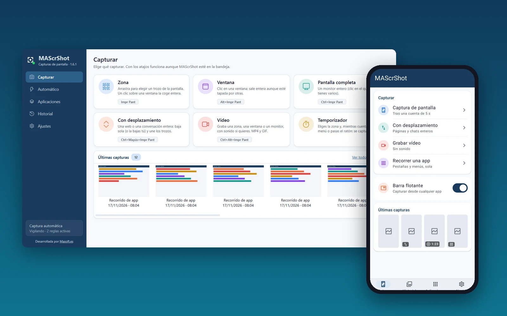
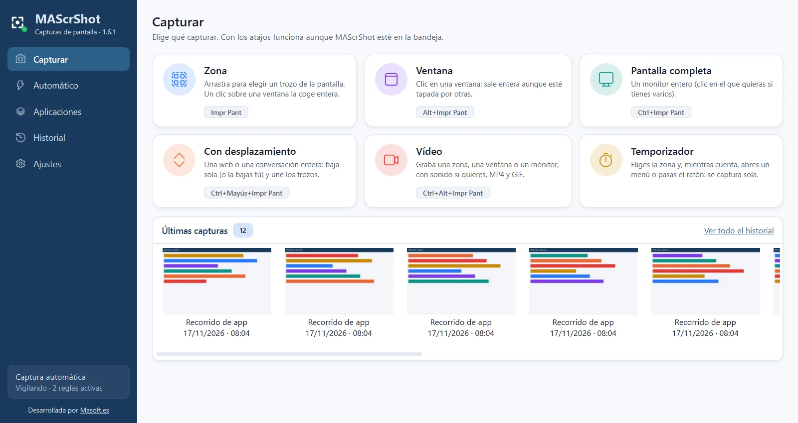
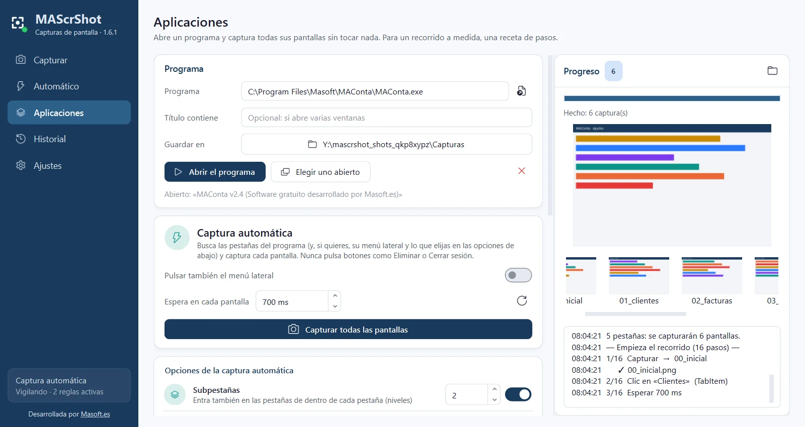
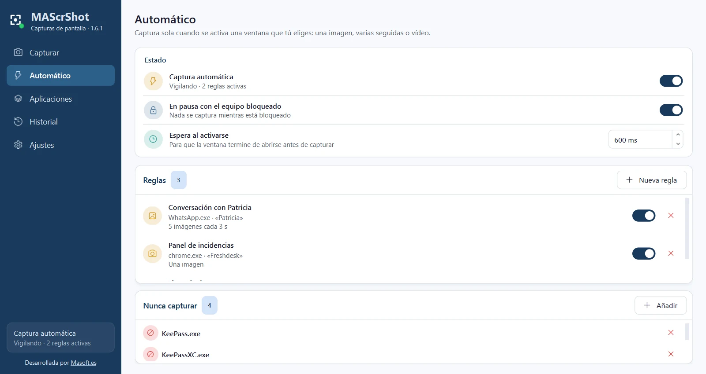
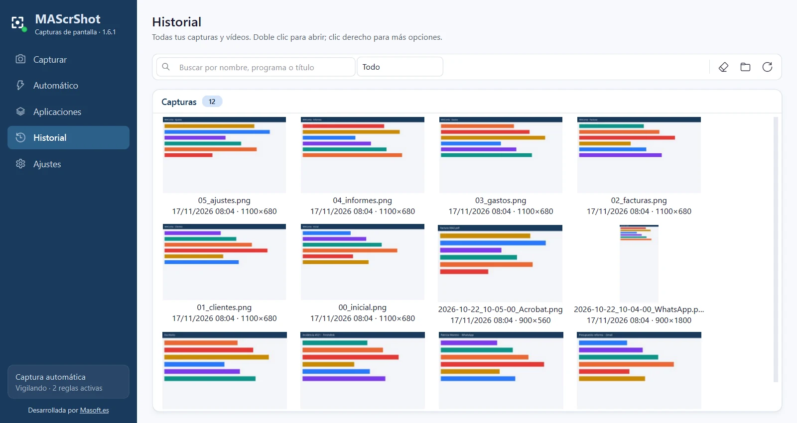
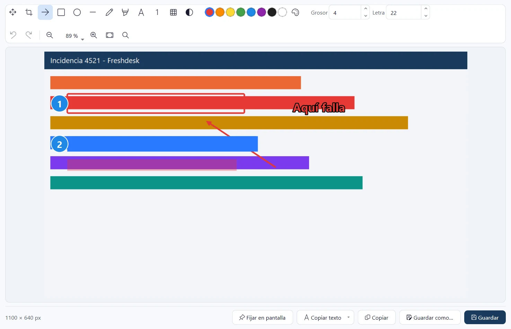
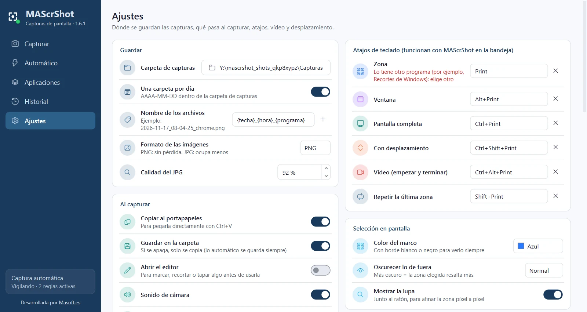
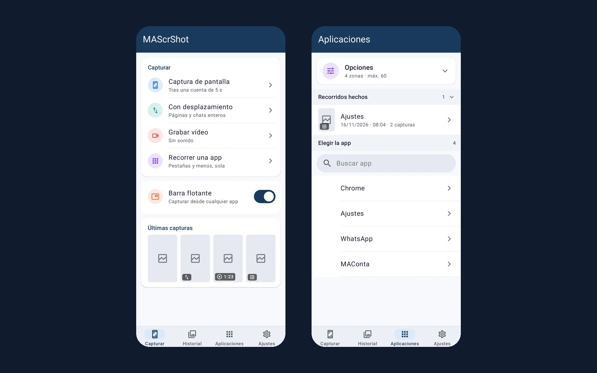
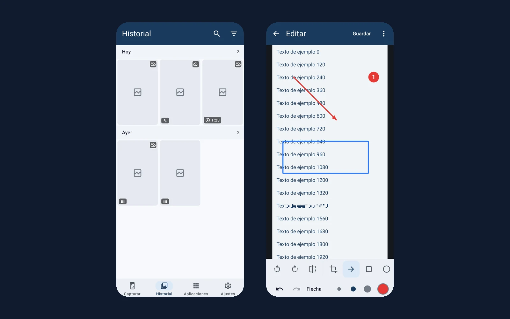
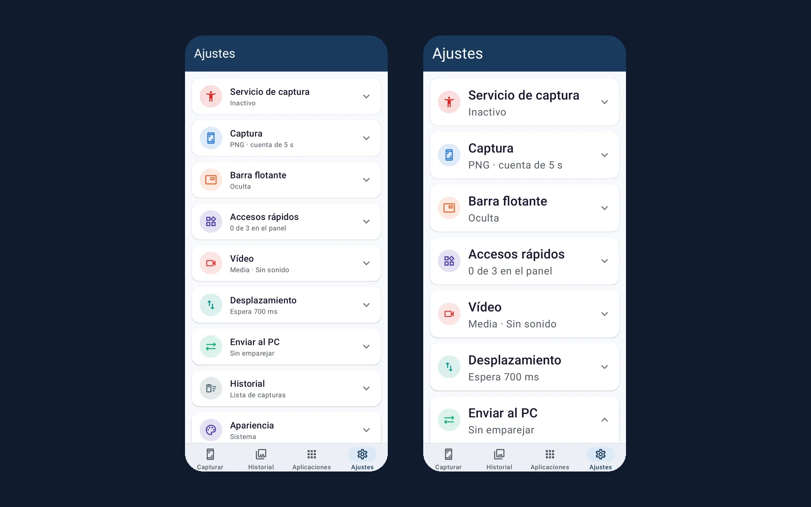

# MAScrShot

Capturas de pantalla de zona, ventana o pantalla completa, capturas largas con desplazamiento, vídeo de la pantalla y captura automática de las pantallas de un programa. Desde la 1.6.0 recibe por la wifi, cifradas, las capturas que haces con MAScrShot para Android.

**Aplicación gratuita para Windows y Android desarrollada por [Masoft.es](https://masoft.es)**

- **Windows 1.6.1:** [instalador](https://github.com/MaSoft/MAScrShot/releases/download/escritorio-v1.6.1/MAScrShot_Setup_v1.6.1.exe) o [ejecutable único](https://github.com/MaSoft/MAScrShot/releases/download/escritorio-v1.6.1/MAScrShot_v1.6.1.exe)
- **Android 1.0.3:** [APK](https://github.com/MaSoft/MAScrShot/releases/download/android-v1.0.3/MAScrShot-1.0.3.apk)

Más información y los manuales también en [masoft.es](https://masoft.es/descargas.html#mascrshot).

## Windows 1.6.1

**Windows 10 / 11 · 64 bits** · [Página de la versión](https://github.com/MaSoft/MAScrShot/releases/tag/escritorio-v1.6.1)

- **Instalador:** [`MAScrShot_Setup_v1.6.1.exe`](https://github.com/MaSoft/MAScrShot/releases/download/escritorio-v1.6.1/MAScrShot_Setup_v1.6.1.exe) · 86,7 MB · SHA-256 `de4b129b00be9fb28535b90990e1cb0f355089939df3a094defc6b66b21354e1`
- **Ejecutable único (sin instalar):** [`MAScrShot_v1.6.1.exe`](https://github.com/MaSoft/MAScrShot/releases/download/escritorio-v1.6.1/MAScrShot_v1.6.1.exe) · 125,7 MB · SHA-256 `836737a9b8f333ee51a667cd33c972e13d2450620ef54cc7d3cdb701660fee49`

### Qué hace
- Zona con lupa de píxeles y medidas, ventana entera aunque esté tapada, sin la sombra de Windows, y pantalla completa.
- Capturas con desplazamiento: webs y conversaciones enteras en una sola imagen, quitando lo que se repite.
- Vídeo de una zona, una ventana o un monitor con el sonido del equipo, del micrófono o de los dos; pausa, clics resaltados, MP4 y GIF.
- Captura automática por programa y título de ventana: una imagen, una ráfaga o vídeo cada vez que se activa.
- Aplicaciones: abre un programa y captura todas sus pantallas con un botón, o sigue una receta de pasos.
- Editor para recortar, marcar y pixelar o difuminar datos; fijar la captura encima de todo.
- Copiar el texto de una captura (normal, con formato o el exacto del programa) sin enviar la imagen a ningún sitio.
- Barra flotante, atajos con Impr Pant configurables, historial con miniaturas, tema claro y oscuro y manual con F1.
- Recibe solas las capturas, vídeos y recorridos de MAScrShot para Android, por la wifi y cifrados, emparejado con un código QR.
- Zoom de la vista en el editor: botones, porcentaje de 25 % a 400 % y Ctrl+rueda donde está el ratón.

### Requisitos

| | |
|---|---|
| Sistema | Windows 10 (versión 2004 o posterior recomendada) u 11 de 64 bits |
| Permisos | Usuario normal: no necesita administrador |
| Instalación | Instalador para tu usuario, sin permisos de administrador, o ejecutable único que se copia y se abre; el único tarda unos segundos más en arrancar porque se descomprime en la carpeta temporal. |
| Espacio | 125,7 MB el programa (incluye el motor de vídeo ffmpeg); las capturas y los vídeos, aparte |
| Copiar el texto | El reconocimiento de texto de Windows en español (suele venir instalado) |

### Capturas

| | |
|---|---|
|  **Capturar.** Zona, ventana, pantalla completa, con desplazamiento, vídeo y temporizador, cada uno con su atajo. |  **Aplicaciones.** Captura automática de todas las pantallas de un programa, con su progreso e índice. |
|  **Captura automática.** Reglas por programa y título: una imagen, una ráfaga o vídeo cada vez que se activa esa ventana. |  **Historial.** Todas las capturas y vídeos con miniatura: abrir, editar, copiar, fijar o hacer GIF. |
|  **Editor.** Flechas, recuadros, texto, números de paso, resaltador y pixelar o difuminar datos antes de compartir. |  **Ajustes.** Carpeta y nombre de las capturas, formato, atajos y qué hacer al capturar. |

## Android 1.0.3

**Android 11 o superior** · [Página de la versión](https://github.com/MaSoft/MAScrShot/releases/tag/android-v1.0.3)

- **APK:** [`MAScrShot-1.0.3.apk`](https://github.com/MaSoft/MAScrShot/releases/download/android-v1.0.3/MAScrShot-1.0.3.apk) · 54,0 MB · SHA-256 `5a2db36ef59e74b04727de7a5bb0c1a599264aa12eb8a1f2ece60ba8e9f2e87c`

### Qué hace
- Captura de pantalla sin pedir permiso cada vez, con cuenta atrás desde la app, la barra o el panel rápido.
- Captura con desplazamiento: baja sola y une los trozos en una imagen alta (webs, chats, listas), con cabecera y pie una sola vez.
- Vídeo con el sonido del móvil, el micrófono o los dos; calidad, tamaño, fotogramas y límite de minutos.
- Barra flotante sobre cualquier app: captura, temporizador, desplazamiento y vídeo; se arrastra y se pliega al borde.
- Accesos rápidos en el panel de arriba: Captura, Grabar pantalla y Barra flotante.
- Aplicaciones: recorre otra app sola (pestañas, barra de abajo, menú lateral y menú ⋮) y nunca pulsa nada prohibido.
- Editor: recortar, girar, voltear, flechas, recuadros, rotulador, resaltador, texto, números, pixelar y difuminar.
- Enviar al PC: emparejado con un QR, cada captura llega sola a MAScrShot del PC, cifrada.

### Requisitos

| | |
|---|---|
| Sistema | Android 11 o superior |
| Permisos | Servicio de accesibilidad de MAScrShot (obligatorio para capturar); avisos (recomendado); micrófono solo para vídeo con sonido. |
| Grabar la pantalla | Android pide permiso al empezar cada grabación. |
| Con el PC | MAScrShot 1.6.0 o posterior en el PC y la misma wifi. |
| Instalación | Se descarga el APK en el móvil y se abre; Android pide permiso para instalar aplicaciones de esa fuente. |

### Capturas

| | |
|---|---|
|  **Capturar y Aplicaciones.** Captura, desplazamiento, vídeo, recorrido de una app y barra flotante; y las opciones del recorrido. |  **Historial y editor.** Las capturas por días, y el editor con flechas, recuadros y números. |
|  **Ajustes y enviar al PC.** Servicio de captura, captura, barra flotante, accesos rápidos, vídeo y envío al PC. |  |

## Instalación y comprobación

- **Windows:** el instalador y el ejecutable no están firmados digitalmente: Windows puede mostrar «Windows protegió su PC». Pulsa «Más información» y «Ejecutar de todas formas».
- **Android:** las aplicaciones no están en Google Play. Se descarga el APK en el móvil y se abre; Android pide permiso para instalar aplicaciones de esa fuente y Google Play Protect puede avisar de que no conoce la aplicación.

Para comprobar una descarga, en PowerShell `Get-FileHash .\<archivo>` debe dar la huella SHA-256 de arriba.

## Aviso legal

MAScrShot es gratuito y se entrega tal cual, sin garantía de ningún tipo. Al descargarlo y usarlo aceptas el aviso legal y las limitaciones de su manual.

> ⚠ Capturar y grabar a otras personas. Grabar la pantalla o el sonido de una llamada, una videoconferencia o una conversación puede requerir informar a los participantes y, según el país y el uso, su consentimiento. La captura automática no debe usarse para vigilar a otras personas sin su conocimiento (en el trabajo, la normativa laboral y de protección de datos exige informar). La responsabilidad del uso es de quien lo configura.
> ⚠ En el móvil: capturar o grabar la pantalla puede recoger datos personales de otras personas (mensajes, fotos, números). Grabar una llamada o conversación en la que participas es legal en España, pero difundirla puede vulnerar la intimidad de los demás; grabar conversaciones ajenas es delito. Respeta los derechos de autor del contenido que captures.

**Limitaciones y exclusión de responsabilidad**
- Las capturas y los vídeos pueden contener datos personales o confidenciales: se guardan sin cifrar en la carpeta elegida. Usa pixelar o difuminar antes de compartirlas.
- Lo automático depende del título y del programa de la ventana; si un programa cambia su título, la regla puede dejar de encajar.
- El contenido protegido (vídeo con DRM, algunas aplicaciones bancarias) puede salir en negro: es Windows quien lo impide.
- La captura con desplazamiento une por coincidencia de imagen: con contenido que se mueve o se repite idéntico puede no encajar.
- El reconocimiento de texto es el de Windows: puede equivocarse con letra pequeña o fondos complicados. Con formato, el tamaño y el color son aproximados y el tipo de letra y la negrita no se copian.
- El texto exacto del programa se guarda en el historial (DATA\historial.db) junto a la captura, sin cifrar, igual que la propia imagen. Las contraseñas nunca se guardan.
- La sección Aplicaciones pulsa controles de verdad en el programa: lo automático solo pulsa pestañas, listas y árboles de navegación y abre menús sin pulsar sus opciones; con Diálogos «…» encendido también pulsa esos botones (salvo los de las palabras prohibidas) y depende de que el programa siga el convenio de que «…» abre una ventana. Una receta hace lo que se le diga. Prueba con datos de prueba, nunca sobre datos reales importantes.
- «Tapar datos» pixela lo que Windows declara como campos de texto o celdas; un dato dibujado de otra forma (una etiqueta, una imagen) no se tapa: revisa las capturas antes de compartirlas.
- La sección Aplicaciones depende de la accesibilidad de Windows: un control sin nombre accesible o dibujado a mano (juegos, lienzos) no se puede pulsar.
- El motor de vídeo es ffmpeg, incluido sin modificar como programa aparte (ffmpeg.exe) bajo la licencia GNU GPL versión 3 (texto de la licencia). Es la compilación de BtbN del 22/10/2026 (versión N-127941-g303510f9d1): su código fuente y la forma de compilarlo están en github.com/BtbN/FFmpeg-Builds, y el de ffmpeg en git.ffmpeg.org. Si alguno de esos enlaces dejara de funcionar, pídelo en hola@masoft.es y te lo enviamos.
- En el móvil, Android no deja capturar las pantallas protegidas por las apps (salen en negro) y el sonido del móvil solo incluye las apps que permiten grabarlo.
- El recorrido de Aplicaciones del móvil depende de cómo cada app expone sus pestañas y menús a la accesibilidad: puede no llegar a todas las pantallas.
- El envío del móvil al PC funciona en la red local (misma wifi), con MAScrShot abierto en el PC.
- MAScrShot se proporciona tal cual, sin garantía de ningún tipo.

Este repositorio solo contiene las aplicaciones compiladas y su documentación. © Masoft.es. Todos los derechos reservados.
